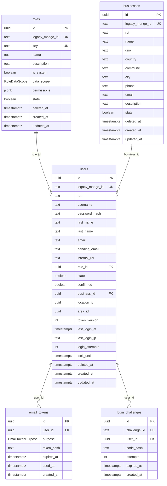

# Wave — modelo de datos

Fuente de verdad en código: `api/prisma/schema.prisma` + migraciones en `api/prisma/migrations/`.  
Este doc lista **todas** las columnas. Se actualiza al cerrar cada sección.

**Convenciones (wave-project §3.3):**

| Prisma | Postgres |
|---|---|
| Modelo `PascalCase` singular | Tabla `snake_case` plural (`@@map`) |
| Campo `camelCase` | Columna `snake_case` (`@map`) |
| `id` uuid | `UUID` |
| Entidades migradas desde Mongo | `legacy_mongo_id` único nullable |
| Fechas | `timestamptz` → API ISO 8601 |
| Soft delete | `deleted_at` solo donde se define entidad por entidad |

Leyenda de tablas: **N** = nullable · **D** = default · **UK** = unique · **PK** / **FK** · **Idx** = índice.

---

## Enums

### `RoleDataScope`

| Valor | Uso |
|---|---|
| `all` | Sin filtro de tenant (superadmin) |
| `business` | Datos de la empresa del usuario |
| `location` | Por ubicación |
| `area` | Por área |
| `self` | Solo propios |

### `EmailTokenPurpose`

| Valor | Uso |
|---|---|
| `confirm_email` | Activar cuenta / confirmar correo |
| `reset_password` | Restablecer contraseña |

---

## Diagrama (Auth migrado + Empresas propuesto)

Todas las columnas (nombres Postgres). `businesses` y la FK `users.business_id` **migradas** (2026-10-21).



---

## `roles` — modelo Prisma `Role`

**Tabla:** `roles` · **Soft delete:** sí (`deleted_at`)  
**Constraints:** `PRIMARY KEY (id)` · `UNIQUE (legacy_mongo_id)` · `UNIQUE (key)`  
**Referencias:** portal viejo `Prisma/core-api/src/models/Role.js` · Wave `schema.prisma` → `Role`

| # | Prisma | Columna Postgres | Tipo | N | D | Notas |
|---|---|---|---|---|---|---|
| 1 | `id` | `id` | `uuid` | | `gen_uuid` | PK |
| 2 | `legacyMongoId` | `legacy_mongo_id` | `text` | ✓ | | UK; ETL |
| 3 | `key` | `key` | `text` | | | UK; ej. `superadmin` |
| 4 | `name` | `name` | `text` | | | |
| 5 | `description` | `description` | `text` | | `""` | |
| 6 | `isSystem` | `is_system` | `boolean` | | `false` | roles seed del sistema |
| 7 | `dataScope` | `data_scope` | `RoleDataScope` | | | enum |
| 8 | `permissions` | `permissions` | `jsonb` | | `[]` | `[{ resource, actions }]` |
| 9 | `state` | `state` | `boolean` | | `true` | activo/inactivo |
| 10 | `deletedAt` | `deleted_at` | `timestamptz` | ✓ | | soft delete |
| 11 | `createdAt` | `created_at` | `timestamptz` | | `now()` | |
| 12 | `updatedAt` | `updated_at` | `timestamptz` | | auto | `@updatedAt` |

**Relaciones Prisma:** `users User[]` (inversa de `User.role`).

---

## `users` — modelo Prisma `User`

**Tabla:** `users` · **Soft delete:** sí (`deleted_at`)  
**Índices:** `(email)`, `(username)` · **UK:** `legacy_mongo_id`  
**FK hoy:** `role_id` → `roles.id` · `business_id` → `businesses.id`  
**FK:** `location_id` → `locations.id` (S3) · **pendiente:** `area_id` (S4)  
**Referencias:** portal viejo `Prisma/core-api/src/models/User.js` · Wave Auth Sección 1

| # | Prisma | Columna Postgres | Tipo | N | D | Notas |
|---|---|---|---|---|---|---|
| 1 | `id` | `id` | `uuid` | | `gen_uuid` | PK |
| 2 | `legacyMongoId` | `legacy_mongo_id` | `text` | ✓ | | UK; seed `seed-superadmin` |
| 3 | `run` | `run` | `text` | | | RUN / identificador |
| 4 | `username` | `username` | `text` | | | Idx |
| 5 | `passwordHash` | `password_hash` | `text` | | | bcrypt |
| 6 | `firstName` | `first_name` | `text` | | | |
| 7 | `lastName` | `last_name` | `text` | | | |
| 8 | `email` | `email` | `text` | | | Idx |
| 9 | `pendingEmail` | `pending_email` | `text` | ✓ | | cambio de correo pendiente |
| 10 | `internalRol` | `internal_rol` | `text` | | `"user"` | `superadmin` \| `admin` \| `user` \| … |
| 11 | `roleId` | `role_id` | `uuid` | ✓ | | FK → `roles.id` |
| 12 | `state` | `state` | `boolean` | | `true` | |
| 13 | `confirmed` | `confirmed` | `boolean` | | `false` | mail de confirmación |
| 14 | `businessId` | `business_id` | `uuid` | ✓ | | FK → `businesses.id`; Idx |
| 15 | `locationId` | `location_id` | `uuid` | ✓ | | FK → `locations.id` |
| 16 | `areaId` | `area_id` | `uuid` | ✓ | | placeholder S4 |
| 17 | `tokenVersion` | `token_version` | `int` | | `0` | invalida JWT en logout |
| 18 | `lastLoginAt` | `last_login_at` | `timestamptz` | ✓ | | |
| 19 | `lastLoginIp` | `last_login_ip` | `text` | ✓ | | |
| 20 | `loginAttempts` | `login_attempts` | `int` | | `0` | |
| 21 | `lockUntil` | `lock_until` | `timestamptz` | ✓ | | bloqueo por intentos |
| 22 | `deletedAt` | `deleted_at` | `timestamptz` | ✓ | | soft delete |
| 23 | `createdAt` | `created_at` | `timestamptz` | | `now()` | |
| 24 | `updatedAt` | `updated_at` | `timestamptz` | | auto | `@updatedAt` |

**Relaciones Prisma:** `role`, `emailTokens`, `loginChallenges`.

**Campos del User Mongo que Wave aún no modela** (referencia; no están en Postgres): p. ej. `birthDate`, `direction`, `phone`, `appAccess`, tokens legacy en el documento, etc. Se agregan solo si una sección lo pide.

---

## `email_tokens` — modelo Prisma `EmailToken`

**Tabla:** `email_tokens` · **Soft delete:** no (se marcan con `used_at` o se dejan expirar)  
**Índices:** `(token_hash)`, `(user_id, purpose)`  
**FK:** `user_id` → `users.id` (`ON DELETE RESTRICT`)  
**Referencias:** Wave `api/src/lib/emailToken.ts` · mails `api/src/emails/`

| # | Prisma | Columna Postgres | Tipo | N | D | Notas |
|---|---|---|---|---|---|---|
| 1 | `id` | `id` | `uuid` | | `gen_uuid` | PK |
| 2 | `userId` | `user_id` | `uuid` | | | FK → `users.id` |
| 3 | `purpose` | `purpose` | `EmailTokenPurpose` | | | enum |
| 4 | `tokenHash` | `token_hash` | `text` | | | SHA-256; Idx |
| 5 | `expiresAt` | `expires_at` | `timestamptz` | | | |
| 6 | `usedAt` | `used_at` | `timestamptz` | ✓ | | null = no usado |
| 7 | `createdAt` | `created_at` | `timestamptz` | | `now()` | |

**Relaciones Prisma:** `user`.

---

## `login_challenges` — modelo Prisma `LoginChallenge`

**Tabla:** `login_challenges` · **Soft delete:** no (se borran al verificar / expirar / max intentos)  
**Índices:** UK `challenge_id`, Idx `(user_id)`, Idx `(expires_at)`  
**FK:** `user_id` → `users.id`  
**Referencias:** portal viejo `Prisma/core-api/src/models/LoginChallenge.js` · Wave `api/src/lib/loginChallenge.ts`

| # | Prisma | Columna Postgres | Tipo | N | D | Notas |
|---|---|---|---|---|---|---|
| 1 | `id` | `id` | `uuid` | | `gen_uuid` | PK interno |
| 2 | `challengeId` | `challenge_id` | `text` | | | UK; UUID público verify/resend |
| 3 | `userId` | `user_id` | `uuid` | | | FK → `users.id`; Idx |
| 4 | `codeHash` | `code_hash` | `text` | | | SHA-256 del código de 6 dígitos |
| 5 | `attempts` | `attempts` | `int` | | `0` | tope: `LOGIN_MFA_MAX_ATTEMPTS` |
| 6 | `expiresAt` | `expires_at` | `timestamptz` | | | Idx; minutos: `LOGIN_MFA_CODE_EXPIRES_MINUTES` |
| 7 | `createdAt` | `created_at` | `timestamptz` | | `now()` | |

**Nota vs Mongo:** el viejo usa TTL index en `expiresAt` y `timestamps` (también `updatedAt`). Wave solo persiste `created_at` (suficiente para el challenge efímero).

**Relaciones Prisma:** `user`.

---

## `businesses` — modelo Prisma `Business` (Sección 2)

Alineado a `Prisma/core-api/src/models/Business.js`.  
**Migraciones:** `20261021192841_add_business`, `20261021192847_businesses_name_active_unique`.

**Tabla:** `businesses` · **Soft delete:** sí · **UK:** `legacy_mongo_id`; unique parcial `lower(name)` donde `deleted_at IS NULL`  
**FK:** `users.business_id` → `businesses.id` (`ON DELETE SET NULL` — Prisma default)

| # | Prisma | Columna Postgres | Tipo | N | D | Notas / Mongo |
|---|---|---|---|---|---|---|
| 1 | `id` | `id` | `uuid` | | `gen_uuid` | PK (en Mongo era `_id`) |
| 2 | `legacyMongoId` | `legacy_mongo_id` | `text` | ✓ | | UK; ETL desde `_id` |
| 3 | `rut` | `rut` | `text` | ✓ | | `rut`; normalizado en service |
| 4 | `name` | `name` | `text` | | | required; unique soft vía índice parcial |
| 5 | `giro` | `giro` | `text` | ✓ | | |
| 6 | `country` | `country` | `text` | ✓ | `"Chile"` | |
| 7 | `commune` | `commune` | `text` | ✓ | | |
| 8 | `city` | `city` | `text` | ✓ | | |
| 9 | `phone` | `phone` | `text` | ✓ | | |
| 10 | `email` | `email` | `text` | ✓ | | |
| 11 | `description` | `description` | `text` | ✓ | | |
| 12 | `state` | `state` | `boolean` | | `true` | |
| 13 | `deletedAt` | `deleted_at` | `timestamptz` | ✓ | | soft delete |
| 14 | `createdAt` | `created_at` | `timestamptz` | | `now()` | Mongo `createdAt` |
| 15 | `updatedAt` | `updated_at` | `timestamptz` | | auto | Mongo `updatedAt` |

**Campo Mongo no llevado (por ahora):** `deletedBy` (ObjectId → User).

**Relaciones Prisma:** `users User[]`, `locations Location[]`.

**Permisos (opción A, 2026-10-21):**

| Acción | Superadmin | Admin empresa |
|---|---|---|
| Listar | todas | solo la suya |
| Crear / soft-delete | sí | no |
| Editar `rut`, `name`, `state` | sí | no |
| Editar contacto (`giro`, `country`, `commune`, `city`, `phone`, `email`, `description`) | sí | sí |

**Referencias código viejo:**

| Pieza | Ruta |
|---|---|
| Modelo | `Prisma/core-api/src/models/Business.js` |
| Rutas | `Prisma/core-api/src/routes/business/business.routes.js` |
| Schemas Zod | `Prisma/core-api/src/schemas/business/business.schemas.js` |
| Service | `Prisma/core-api/src/services/business/business.service.js` |
| UI | `Prisma/client/src/pages/EmpresasPage.jsx` |

---

## `locations` — modelo Prisma `Location` (Sección 3)

Alineado a `Prisma/core-api/src/models/Location.js`.  
**Migraciones:** `20261022145716_add_location`, `20261022145722_locations_name_business_active_unique`.

**Tabla:** `locations` · **Soft delete:** sí · **UK:** `legacy_mongo_id`; unique parcial `(business_id, lower(name))` donde `deleted_at IS NULL`  
**FK:** `business_id` → `businesses.id` (`ON DELETE RESTRICT`) · `users.location_id` → `locations.id`

| # | Prisma | Columna Postgres | Tipo | N | D | Notas / Mongo |
|---|---|---|---|---|---|---|
| 1 | `id` | `id` | `uuid` | | `gen_uuid` | PK |
| 2 | `legacyMongoId` | `legacy_mongo_id` | `text` | ✓ | | UK; ETL desde `_id` |
| 3 | `name` | `name` | `text` | | | required; unique soft por empresa |
| 4 | `businessId` | `business_id` | `uuid` | | | FK → `businesses`; Mongo `businessID` |
| 5 | `country` | `country` | `text` | ✓ | `"Chile"` | |
| 6 | `commune` | `commune` | `text` | ✓ | | |
| 7 | `city` | `city` | `text` | ✓ | | |
| 8 | `phone` | `phone` | `text` | ✓ | | |
| 9 | `email` | `email` | `text` | ✓ | | |
| 10 | `description` | `description` | `text` | ✓ | | |
| 11 | `state` | `state` | `boolean` | | `true` | |
| 12 | `deletedAt` | `deleted_at` | `timestamptz` | ✓ | | soft delete |
| 13 | `createdAt` | `created_at` | `timestamptz` | | `now()` | |
| 14 | `updatedAt` | `updated_at` | `timestamptz` | | auto | |

**Campo Mongo no llevado (por ahora):** `deletedBy`.

**Relaciones Prisma:** `business`, `users User[]`.

**Referencias código viejo:** `Prisma/core-api/src/models/Location.js`, rutas `location/location.routes.js`.

---

## Roadmap de tablas (secciones siguientes)

Detalle de columnas se escribe aquí al entrar a cada slice.

| Sección | Tablas Postgres | Mongo |
|---|---|---|
| 2 | `businesses` | `Business` |
| 3 | `locations` | `Location` |
| 4 | `areas` | `Area` |
| 5 | catálogos | `Rank`, `AcademicDegree`, `CompetencyCertificate`, `Course`, `Muelle`, `Travesia` |
| 6 | (UI) `roles` | `Role` |
| 7 | tripulantes + docs | `CrewMember`, `CrewMemberDocument`, `CrewMemberMuelle`, `CrewMemberTravesia` |
| 8 | cursos tripulante | `CrewMemberCourse`, `CompetencyCertificateCourse` |
| 9 | outbox | `NotificationOutbox` |
| 10 | auditoría / sistema | `ActivityLog`, `SystemAnnouncement`, `SystemState` |
| 11 | KPIs (lecturas) | — |

Modelos Mongo: `Prisma/core-api/src/models/`.

---

## Cómo ver las tablas reales

```bash
cd api && npx prisma studio
```

---

## Historial

| Fecha | Cambio |
|---|---|
| 2026-10-21 | Doc inicial Auth + contrato `businesses` |
| 2026-10-21 | Inventario completo de columnas + diagrama Mermaid completo |
| 2026-10-21 | `businesses` migrada + FK `users.business_id` + unique parcial `name` |
